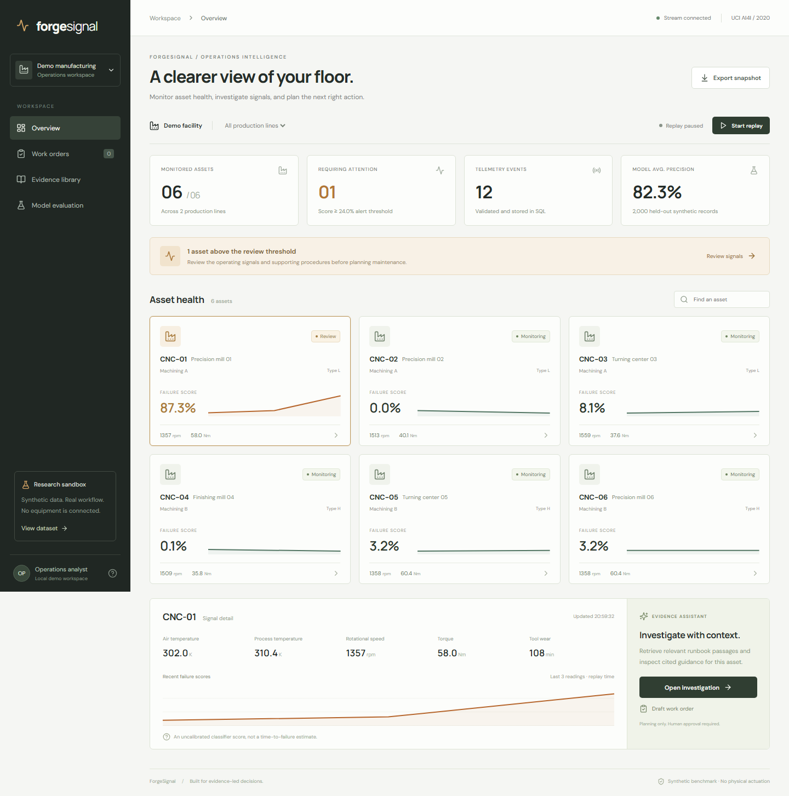
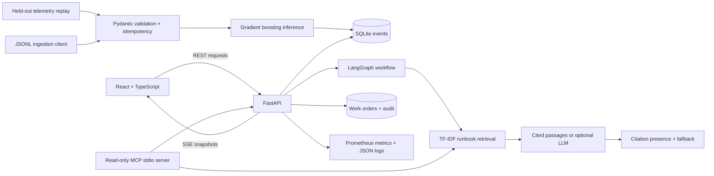

# ForgeSignal

### Operations intelligence, from sensor signal to a reviewed maintenance decision.

[](https://github.com/Pavan-amikula/forgesignal/actions/workflows/ci.yml)


ForgeSignal gives a manufacturing analyst one place to monitor a fleet, inspect a failure score, retrieve cited maintenance guidance, and send an evidence-backed work order to a supervisor. It joins a full-stack product workflow with reproducible ML evaluation, a bounded LangGraph assistant, read-only MCP tools, and observable backend services.

**A working local portfolio application.** Telemetry is replayed from a public **synthetic** benchmark. The six assets are fictional display entities. Scores classify the current reading; they do not forecast a future failure time. No physical equipment is connected.



## Watch the product work

[](https://github.com/Pavan-amikula/forgesignal/raw/refs/heads/main/docs/media/walkthrough.mp4)

**[Watch/download the full MP4 demonstration](https://github.com/Pavan-amikula/forgesignal/raw/refs/heads/main/docs/media/walkthrough.mp4)** · [Investigation screenshot](docs/media/investigation.png) · [Approval workflow](docs/media/work-orders.png) · [Evaluation](docs/media/evaluation.png) · [Mobile](docs/media/mobile.png)

The silent recording has explanatory captions and shows the real browser, server replay, retrieval response, work-order approval, and evaluation screens. It uses extractive mode, so reviewers can reproduce it without buying an LLM API key. The GIF is a lower-resolution preview of the same recording.

## Try it in five minutes

Prerequisites: Python **3.13**, Node **22**, and npm. The attributed dataset is included. Run from the repository root.

**Windows PowerShell**

```powershell
./scripts/start.ps1
```

**macOS / Linux / GitHub Codespaces**

```bash
python -m venv .venv
source .venv/bin/activate
pip install -r requirements.lock.txt
cd frontend
npm ci
npm run build
cd ..
python -m backend.ml
python -m uvicorn backend.main:app --host 127.0.0.1 --port 8000
```

Open **[localhost:8000](http://localhost:8000)**. API schema: **[localhost:8000/docs](http://localhost:8000/docs)**. Codespaces users can forward port 8000 with the supplied dev container, then run the final Uvicorn command in the terminal.

1. Start replay and watch event counts and asset readings update over SSE.
2. Pause replay and select an asset. Open investigation and ask about torque, cooling, or tool wear.
3. Inspect the response mode, source passages and execution trace.
4. Draft a work order. In **Work orders**, expand the captured evidence and approve or reject it.
5. Open **Model evaluation** to inspect the baseline, confusion matrix and methodological limits.

**Docker alternative:** `docker compose up --build`. Add `--profile monitoring` before `up` to start Prometheus at port 9090. Compose binds the app to loopback and persists SQL state in a named volume. See [deployment notes](docs/DEPLOYMENT.md) for container/cloud validation status.

## What is implemented

| Capability | Working implementation |
|---|---|
| User-centered frontend | React 19, strict TypeScript, custom responsive CSS, labeled sensor units, asset search, line filtering, source inspection and JSON export |
| Backend and SQL | FastAPI, Pydantic input contracts, SQLite WAL transactions, indexed asset history, unique event IDs and idempotent ingestion |
| Real-time delivery | Server-owned two-second replay, SSE snapshots, connection status and browser reconnect |
| ML pipeline | Six-feature histogram gradient boosting, train/validation/test separation, validation-only threshold selection, baseline and saved JSON report |
| Evidence assistant | LangGraph retrieve → compose → validate; local sparse TF-IDF vector retrieval; cited extractive responses; optional LLM synthesis with timeout and fallback |
| Human oversight | Proposals capture immutable evidence snapshots; one terminal approval/rejection; transactional decision audit; optional supervisor bearer token |
| MCP integration | Official Python SDK, genuine stdio server/client, `search_runbooks` and `fleet_snapshot` read-only tools |
| Reliability | Structured request logs, correlation IDs, Prometheus request/latency/ingestion metrics, health check and provider-failure handling |
| Delivery | Locked dependencies, Docker multi-stage build, GitHub Actions checks and GHCR image publishing; Azure Bicep evaluation template |

This is a bounded workflow, rather than an autonomous equipment-control agent. Its vector index is an in-process sparse matrix, **not a vector database**. LangGraph is used in both extractive and LLM modes.

## Measured results

The frozen model uses **6,000 training / 2,000 validation / 2,000 test** records, stratified with seed 42. The threshold **0.24** maximizes validation F1. Failure subtype labels and identifiers are excluded from predictors.

| Held-out metric | Gradient boosting | Prior baseline |
|---|---:|---:|
| Average precision | **0.8233** | 0.0340 |
| ROC AUC | **0.9732** | 0.5000 |
| Precision at selected threshold | **0.7162** | 0.0000 |
| Recall at selected threshold | **0.7794** | 0.0000 |
| F1 at selected threshold | **0.7465** | 0.0000 |

Test failures: **68 / 2,000**. Confusion matrix: TN=1,911, FP=21, FN=15, TP=53. Scores are uncalibrated. The random split does not establish temporal or cross-plant generalization. No downtime reduction, cost savings or production adoption is claimed.

Other recorded checks:

- **18 automated tests** covering ingestion, invalid inputs, duplicate IDs, authorization, approval transitions, evidence snapshots, retrieval, abstention, provider failure and citation validation.
- **12/12 authored retrieval/abstention smoke cases**. This is a small vocabulary-overlapping test set, not a RAGAS faithfulness score or independent benchmark.
- Real SSE replay and both MCP tools exercised through an actual stdio client session.
- Ten browser workflow/responsive checks; no JavaScript page errors; 390px viewport passed the horizontal overflow check.
- Local snapshot endpoint: **8.12 ms median / 9.21 ms p95**, 50 sequential loopback requests. This is an environment-specific observation, not a throughput or production SLO claim.

Machine-readable evidence: [model report](artifacts/model-report.json), [retrieval report](artifacts/retrieval-report.json), [live verification](artifacts/live-verification.json), [browser verification](artifacts/browser-verification.json), [JUnit](artifacts/junit.xml), [exported demo snapshot](artifacts/demo-snapshot.json). The demo snapshot shows synthetic operations and demo decisions only.

## Architecture



The replay samples independent held-out observations and assigns fictional asset IDs. Chart sequences show arrival order, not a genuine machine's degradation trajectory. SQL state survives local restarts; training regenerates the trusted local model artifact. The default service uses a single process because replay scheduling is process-local.

## Reproduce the evidence

```bash
python -m backend.ml
pytest -q --junitxml=artifacts/junit.xml
python -m scripts.evaluate_retrieval
cd frontend && npm ci && npm run build
```

With the application running in another terminal:

```bash
python -m scripts.verify_live
python -m scripts.import_telemetry data/example-events.jsonl
```

The optional browser recording script requires `pip install playwright imageio-ffmpeg` and `python -m playwright install chromium`; then run `python -m scripts.browser_demo`. It creates demo decisions in the running workspace. Browser/media tools are intentionally excluded from the server runtime lock. Repeated imports preserve unique event IDs and report duplicates.

## Optional LLM mode and MCP

Set `OPENAI_API_KEY` in the process environment before starting the server. `LLM_MODEL` defaults to `gpt-4.1-mini`. The key stays on the backend. LLM mode sends the selected asset snapshot and retrieved demo passages to the provider; do not use confidential plant data without an approved data policy. No real provider call was made for the recorded results; provider failure and missing citations were tested with controlled mocks. A citation-presence check is not a semantic faithfulness guarantee.

Start the read-only MCP server with `python -m backend.mcp_server`. Configure an MCP client with the repository as its working directory and the virtual environment's Python executable. The SDK is pinned to v1 (`mcp<2`) to match `FastMCP`. The server exposes no decision or machine-control tools. See [runbook](docs/RUNBOOK.md).

## Engineering decisions and handoff

- [Research: papers, dataset, reference projects and interface sources](docs/RESEARCH.md)
- [Architecture decisions and scaling boundaries](docs/ARCHITECTURE.md)
- [Job-description evidence map](docs/REQUIREMENTS.md)
- [Deployment and cloud template](docs/DEPLOYMENT.md)
- [Operating runbook](docs/RUNBOOK.md)
- [Team playbook and proposed sprint backlog](docs/TEAM_PLAYBOOK.md)
- **[Full project text and resume handoff](docs/RESUME_HANDOFF.md)**

The project provides engineering and team-enablement artifacts. It does not prove years of experience, client employment, actual pair programming, mentoring or sprint participation. Use the handoff to describe the technical work accurately and prepare to explain it in an interview.

## Data, research and license

AI4I 2020 Predictive Maintenance Dataset [Dataset]. (2020). UCI Machine Learning Repository. [DOI: 10.24432/C5HS5C](https://doi.org/10.24432/C5HS5C). **CC BY 4.0**; unchanged CSV redistribution and transformations are documented in [dataset attribution](data/ATTRIBUTION.md).

Research references include [Lewis et al. — RAG](https://arxiv.org/abs/2005.11401), [Yao et al. — ReAct](https://arxiv.org/abs/2210.03629), [Es et al. — Ragas](https://arxiv.org/abs/2309.15217), [Azure's document RAG sample](https://github.com/Azure-Samples/azure-search-openai-demo), and [Microsoft's real-time operations accelerator](https://github.com/microsoft/real-time-intelligence-operations-solution-accelerator). They informed design choices; the project does not reproduce their research results or claim affiliation. UI interaction research includes Grafana and IBM Carbon; the implementation uses original React/CSS layouts and Lucide icons. Full links and distinctions appear in the research notes.

Code: [MIT](LICENSE). Dataset: [CC BY 4.0](https://creativecommons.org/licenses/by/4.0/). Runbooks are illustrative project content, not approved industrial instructions.
